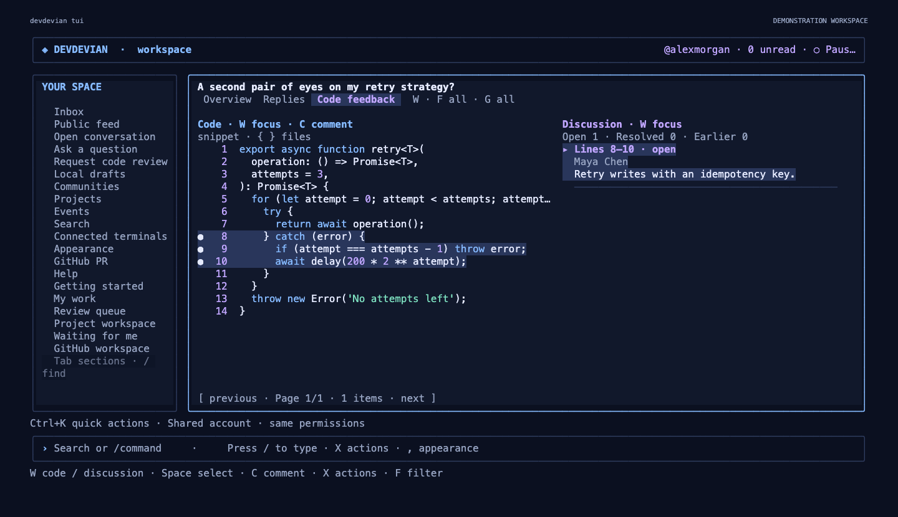
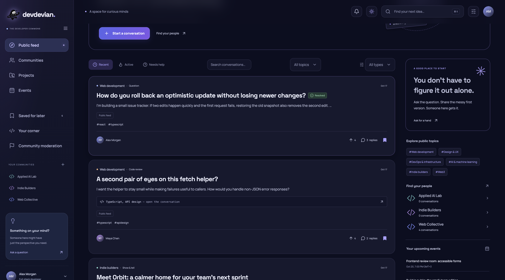
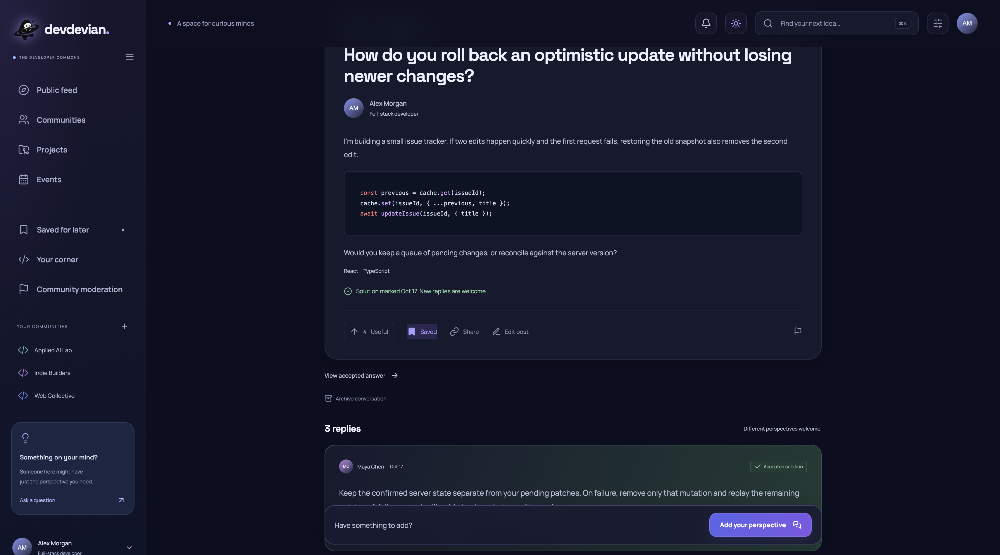
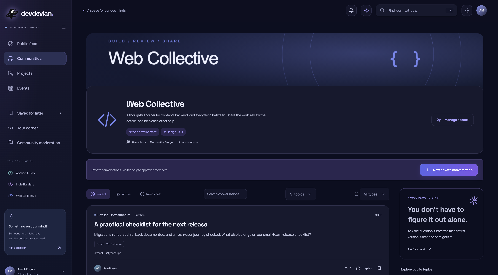
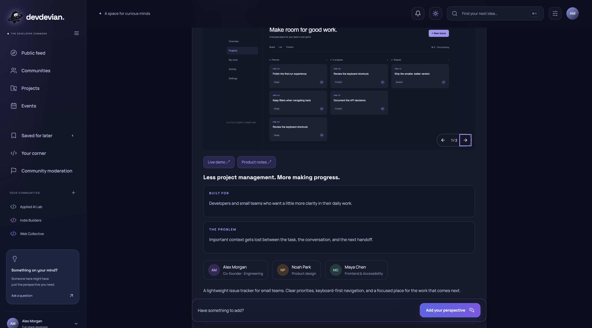

<div align="center">
  
  <h1>Devdevian</h1>
  <p><strong>A work in good company.</strong></p>
  <p>An open-source forum for programmers to ask, review, share, and build together.</p>
  <p>
    <a href="https://github.com/Tenyokj/devdevian/actions/workflows/checks.yml"></a>
    <a href="LICENSE"></a>
    <a href="package.json"></a>
    <a href="https://www.npmjs.com/package/@tenyokjs/devdevian-cli"></a>
    <a href="https://nodejs.org/"></a>
    
  </p>
  <p><a href="https://devdevian.vercel.app/">Website</a> · <a href="https://devdevian.vercel.app/app">Open the forum</a> · <a href="https://devdevian.vercel.app/updates">What’s new</a> · <a href="https://devdevian.vercel.app/faq">FAQ</a> · <a href="https://devdevian.vercel.app/docs">Documentation</a> · <a href="CONTRIBUTING.md">Contribute</a> · <a href="https://github.com/Tenyokj/devdevian/issues">Report a bug</a></p>
</div>

[Devdevian V1 — From conversation to contribution](https://github.com/Tenyokj/devdevian/releases/tag/v1.0.0)

[Watch the launch film](https://www.youtube.com/watch?v=qjFs2yy5uz0) · [Find your way around the source](docs/source-map.md) · [Full changelog](CHANGELOG.md)

## Your browser, your colors

Browse the [Extensions library](https://devdevian.vercel.app/app#extensions), install account-specific code packages and develop your own layouts, panels and tools locally. JavaScript runs in an isolated sandbox with explicit SDK capabilities; light/dark CSS covers the app shell. Each immutable version has its own review status. [Extension SDK and examples](https://devdevian.vercel.app/docs/extensions)

## Devdevian Rooms

Find the next task, take responsibility and keep the decisions with the work. Project rooms add a shared Open / In progress / Ready board, named assignees, pinned decisions with edit history and permission-scoped activity in browser and CLI. Code reviews gain syntax colors while preserving exact snapshots and line anchors. [Rooms guide](docs/rooms.md)

## Your GitHub workspace

Connect a GitHub App to selected repositories, inspect public/private PRs and issues, read diffs and commit checks, and prepare an explicit Devdevian review from chosen changes. Browser and CLI use your own GitHub permissions. [GitHub workspace guide](docs/github-app.md)

## From task to contribution

Pick up a Room task, submit a result or a checked public GitHub PR, and get feedback from the project owner. Results and decisions keep their exact revision history in the browser and terminal. [Contributions guide](docs/contributions.md)

## Review Flow

Ask a specific developer to review an immutable code version. Follow **Waiting for me**, accept an invitation and share **Changes requested** or **No objections** for the exact snapshot you inspected. New revisions can link back to earlier remarks without silently resolving them or inheriting an old verdict. Available across browser and CLI with the same private access rules. [Review Flow guide](docs/review-flow.md)

## Workspaces 0.2

Projects now keep work requests and immutable review iterations together across the browser and CLI. Compare revisions, open the exact code behind an earlier remark, and share selected local files or Git changes from a project-linked terminal. Existing community visibility and account permissions still apply. [Workspace guide](docs/workspaces-0.2.md) · [CLI commands](packages/cli/README.md#workspaces-02)

## A place for the work and the people behind it

Devdevian brings technical conversations, code feedback, projects, and developer communities into one place. Topics organize the public feed; private communities give approved members a separate space to work together.

This is a live early release, built in the open. Contributions from developers, designers, writers, and people who can explain a reproducible bug are welcome. Features are still evolving; do not use the forum as your only copy of important work.

## Devdevian in your terminal

The same forum, account and permissions, inside your editor or favorite terminal. Ask questions, review project files and Git diffs, follow conversations, manage Projects and Events, and customize your workspace with themes and Devi.

```sh
npm install -g @tenyokjs/devdevian-cli@alpha
devdevian tui
```

Requires Node.js 24+. Login is approved in your browser. Use `devdevian open` for a separate terminal window. Reviews can optionally carry [GitHub repository, branch, base commit and PR context](docs/github-context.md), visible in both clients. Read a public GitHub PR, inspect its diff and select changes for a Devdevian review with the [public PR workflow](docs/github-pr-reader.md). This does not write back to GitHub.

[CLI documentation](packages/cli/README.md) · [npm package](https://www.npmjs.com/package/@tenyokjs/devdevian-cli) · [Version history](packages/cli/VERSIONS.md)



## Inside the forum

| Feature | What you can do |
| --- | --- |
| Conversations | Share public conversations through readable URLs with server-rendered content and link previews. Ask a question, start a discussion, request a code review, or post a Show & tell. Add code, files, images, and labeled links. |
| Useful answers | Reply in threads, vote, save posts, and mark an accepted answer on your question or code review. |
| Private communities | Request membership, discuss privately with approved members, and appoint community validators. |
| Projects | Present a project with a logo, screenshots, team, links, and a dedicated feedback conversation. |
| Events | Schedule in an organizer timezone, join an event, and download a calendar entry. Meeting links are restricted to attendees and organizers. |
| Your corner | Keep a permanent @username, customize your profile, and find your conversations, projects, events, and communities. |
| Drafts and follows | Restore browser-local conversation drafts, browse Following, manage topic/conversation subscriptions, and receive in-app @mention alerts with direct reply links. |
| Everyday essentials | Google/GitHub sign-in, verified email registration, search, pagination, notifications, and responsive light/dark interfaces. |

## Take a look

Illustrative product captures from a fictional screenshot dataset; these are not a directory of real users.

<table>
  <tr>
    <td width="50%"><a href="public/screenshots/feed-screen.png"></a><br /><strong>Public feed</strong></td>
    <td width="50%"><a href="public/screenshots/conversation-screen.png"></a><br /><strong>Conversations & answers</strong></td>
  </tr>
  <tr>
    <td width="50%"><a href="public/screenshots/community-screen.png"></a><br /><strong>Your community</strong></td>
    <td width="50%"><a href="public/screenshots/orbit-screen.png"></a><br /><strong>Projects & feedback</strong></td>
  </tr>
</table>

## Start using Devdevian

Open [the forum](https://devdevian.vercel.app/app), sign in, and choose your permanent username. Browse the public feed, join a community, or start with a focused question. If you connect another sign-in provider with the same email, a one-time email confirmation keeps the existing account and its activity together.

Public conversation links open without an account; sign in on the same page to reply. The forum workspace and existing `/app#post/…` links remain available.

Read the [user guide](docs/user-guide.md) for sharing content, joining communities, accepted answers, events, privacy settings, and account deletion. The [moderation guide](docs/moderation.md) explains the difference between community validators and platform moderators.

## Built with

React, Vite, Node.js, and Express power the application. The hosted instance uses Vercel, Turso/libSQL, Supabase Storage, Google/GitHub OAuth, and Brevo transactional email. Local development uses SQLite and local files. These are technology credits, not sponsorship or partnership claims.

See [architecture](docs/architecture.md), [development](docs/development.md), and [self-hosting/deployment](docs/deployment.md). Brand assets and attribution are listed in [THIRD_PARTY_NOTICES.md](THIRD_PARTY_NOTICES.md).

## Find what you need

| If you want to… | Start here |
| --- | --- |
| Use the forum or resolve a common question | [FAQ](https://devdevian.vercel.app/faq) · [User guide](docs/user-guide.md) |
| Use the terminal or review a public PR | [CLI guide](packages/cli/README.md) · [GitHub PR reader](docs/github-pr-reader.md) |
| Understand how the code fits together | [Source map](docs/source-map.md) · [Architecture](docs/architecture.md) |
| Make and verify a change | [Contributing](CONTRIBUTING.md) · [Development](docs/development.md) · [Tests](tests/README.md) |
| Operate your own instance | [Deployment](docs/deployment.md) · [Recovery](docs/reliability.md) |
| Follow product and package changes | [What’s new](https://devdevian.vercel.app/updates) · [Changelog](CHANGELOG.md) · [CLI versions](packages/cli/VERSIONS.md) |

## Develop locally

Requires **Node.js 24+** and npm.

```sh
npm ci
cp .env.example .env
npm run dev
```

Visit `http://127.0.0.1:4173` for the landing and `/app` for the forum. A normal checkout starts with an empty local database. OAuth and email registration require your own development credentials; they are never simulated in ordinary operation. For disposable local accounts and isolated test data, follow the [development guide](docs/development.md).

```sh
npm test                # build + isolated API, identity and interface checks
npm run test:browser    # Chromium checks, desktop/tablet/mobile captures
npm run test:load       # disposable local workload, never production
```

Tests do not reset production or your normal development data. Never put production credentials into a local development configuration. Do not commit `.env*`, database files, uploads, or backups.

For production migrations, encrypted backups, restore verification, health checks and configurable quotas, see [reliability and recovery](docs/reliability.md). Scheduled backups require repository secrets and a successful restore check before they can be considered active.

## Contribute

Start with [CONTRIBUTING.md](CONTRIBUTING.md) and the [code of conduct](CODE_OF_CONDUCT.md). Keep changes focused, explain the resulting behavior, and include relevant validation. Discuss major product or architectural changes in an issue first. No CLA is required; contributions are submitted under GPL-3.0-only.

For vulnerabilities, follow [SECURITY.md](SECURITY.md) and contact maintainers privately. Public issues are for non-sensitive bugs and feature discussions.

## Privacy, terms, and license

[Privacy & Security](https://devdevian.vercel.app/privacy) · [Terms of Use](https://devdevian.vercel.app/terms) · [Changelog](CHANGELOG.md)

The software is licensed under the **GNU General Public License, version 3 only**. See [LICENSE](LICENSE). This does not automatically license user posts, code snippets, images, or attachments under GPL; their authors retain their respective rights.

GitHub Issues can become room tasks with explicit previews and private sharing consent. Link PRs to tasks and exact contribution revisions, and inspect current checks in the browser or terminal. [Workflow guide](docs/github-room-work.md) · [Security verification](docs/security-review-0.7.md).
