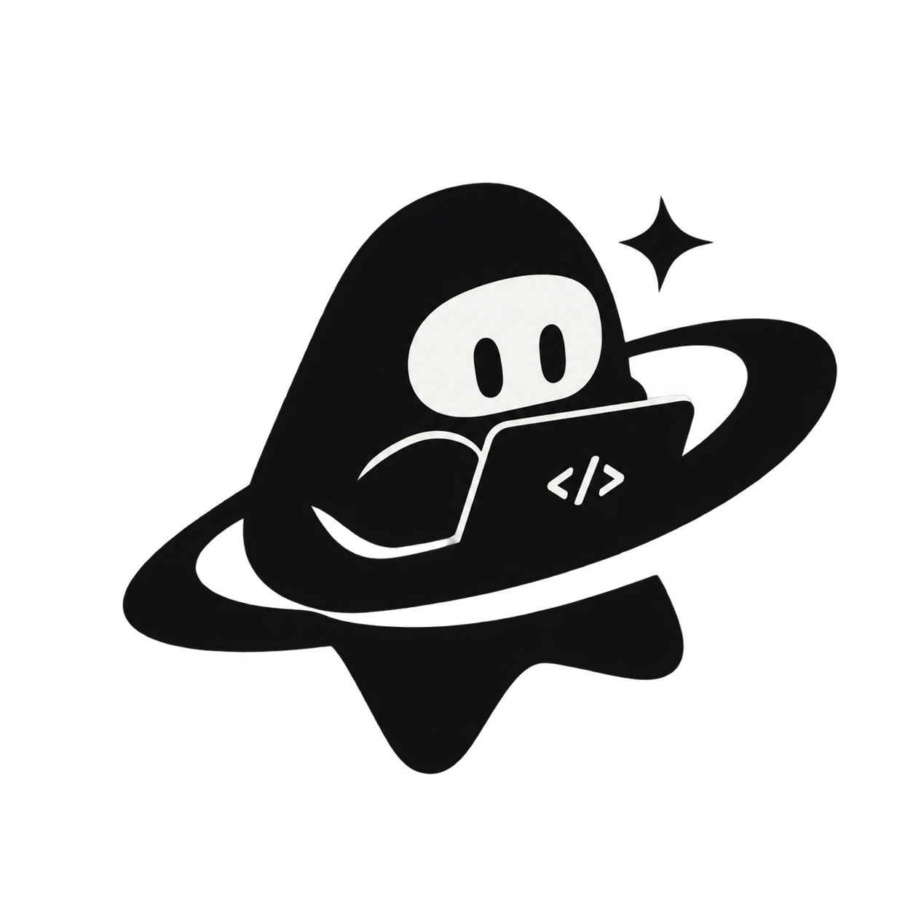
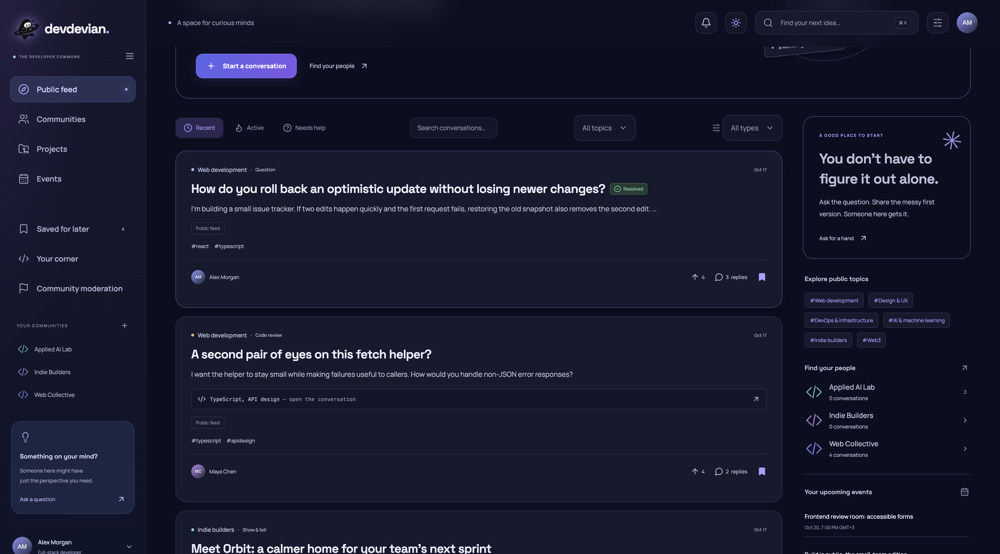
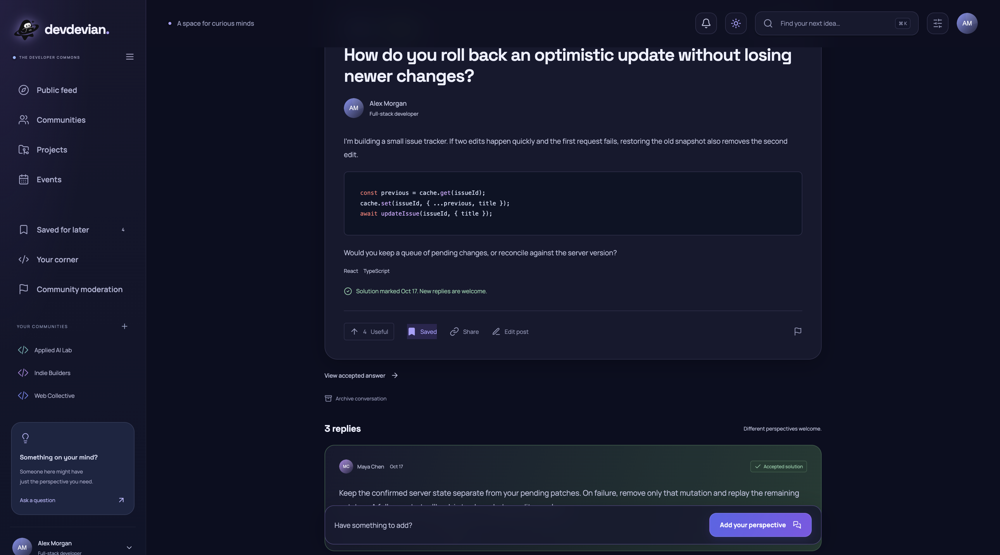
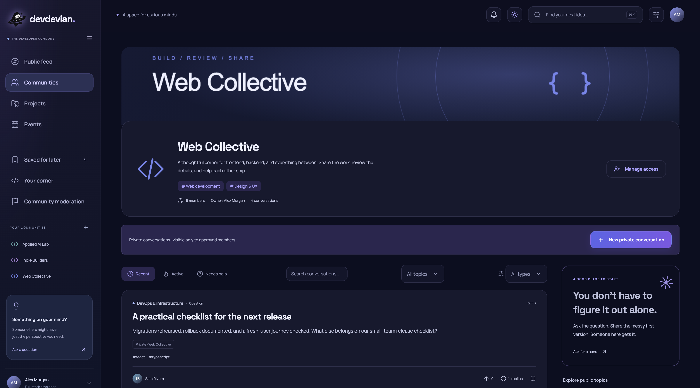
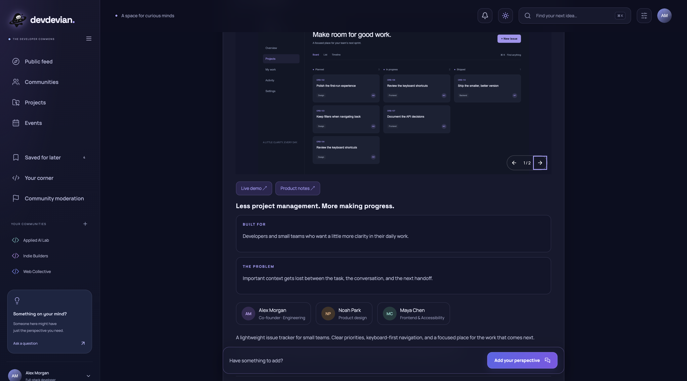

<div align="center">
  
  <h1>Devdevian</h1>
  <p><strong>A work in good company.</strong></p>
  <p>An open-source forum for programmers to ask, review, share, and build together.</p>
  <p>
    <a href="https://github.com/Tenyokj/devdevian/actions/workflows/checks.yml"></a>
    <a href="LICENSE"></a>
    <a href="package.json"></a>
    <a href="https://nodejs.org/"></a>
    
  </p>
  <p><a href="https://devdevian.vercel.app/">Website</a> · <a href="https://devdevian.vercel.app/app">Open the forum</a> · <a href="docs/README.md">Documentation</a> · <a href="CONTRIBUTING.md">Contribute</a> · <a href="https://github.com/Tenyokj/devdevian/issues">Report a bug</a></p>
</div>

## A place for the work and the people behind it

Devdevian brings technical conversations, code feedback, projects, and developer communities into one place. Topics organize the public feed; private communities give approved members a separate space to work together.

This is a live early release, built in the open. Contributions from developers, designers, writers, and people who can explain a reproducible bug are welcome. Features are still evolving; do not use the forum as your only copy of important work.

## Inside the forum

| Feature | What you can do |
| --- | --- |
| Conversations | Ask a question, start a discussion, request a code review, or post a Show & tell. Add code, files, images, and labeled links. |
| Useful answers | Reply in threads, vote, save posts, and mark an accepted answer on your question or code review. |
| Private communities | Request membership, discuss privately with approved members, and appoint community validators. |
| Projects | Present a project with a logo, screenshots, team, links, and a dedicated feedback conversation. |
| Events | Schedule in an organizer timezone, join an event, and download a calendar entry. Meeting links are restricted to attendees and organizers. |
| Your corner | Keep a permanent @username, customize your profile, and find your conversations, projects, events, and communities. |
| Everyday essentials | Google/GitHub sign-in, verified email registration, search, pagination, notifications, and responsive light/dark interfaces. |

## Take a look

Illustrative product captures from a fictional screenshot dataset; these are not a directory of real users.

<table>
  <tr>
    <td width="50%"><a href="public/screenshots/feed-screen.png"></a><br /><strong>Public feed</strong></td>
    <td width="50%"><a href="public/screenshots/conversation-screen.png"></a><br /><strong>Conversations & answers</strong></td>
  </tr>
  <tr>
    <td width="50%"><a href="public/screenshots/community-screen.png"></a><br /><strong>Your community</strong></td>
    <td width="50%"><a href="public/screenshots/orbit-screen.png"></a><br /><strong>Projects & feedback</strong></td>
  </tr>
</table>

## Start using Devdevian

Open [the forum](https://devdevian.vercel.app/app), sign in, and choose your permanent username. Browse the public feed, join a community, or start with a focused question. If you connect another sign-in provider with the same email, a one-time email confirmation keeps the existing account and its activity together.

Read the [user guide](docs/user-guide.md) for sharing content, joining communities, accepted answers, events, privacy settings, and account deletion. The [moderation guide](docs/moderation.md) explains the difference between community validators and platform moderators.

## Built with

React, Vite, Node.js, and Express power the application. The hosted instance uses Vercel, Turso/libSQL, Supabase Storage, Google/GitHub OAuth, and Brevo transactional email. Local development uses SQLite and local files. These are technology credits, not sponsorship or partnership claims.

See [architecture](docs/architecture.md), [development](docs/development.md), and [self-hosting/deployment](docs/deployment.md). Brand assets and attribution are listed in [THIRD_PARTY_NOTICES.md](THIRD_PARTY_NOTICES.md).

## Develop locally

Requires **Node.js 24+** and npm.

```sh
npm ci
cp .env.example .env
npm run dev
```

Visit `http://127.0.0.1:4173` for the landing and `/app` for the forum. A normal checkout starts with an empty local database. OAuth and email registration require your own development credentials; they are never simulated in ordinary operation. For disposable local accounts and isolated test data, follow the [development guide](docs/development.md).

```sh
npm test                # build + isolated API, identity and interface checks
npm run test:browser    # Chromium checks, desktop/tablet/mobile captures
```

Tests do not reset production or your normal development data. Never put production credentials into a local development configuration. Do not commit `.env*`, database files, uploads, or backups.

## Contribute

Start with [CONTRIBUTING.md](CONTRIBUTING.md) and the [code of conduct](CODE_OF_CONDUCT.md). Keep changes focused, explain the resulting behavior, and include relevant validation. Discuss major product or architectural changes in an issue first. No CLA is required; contributions are submitted under GPL-3.0-only.

For vulnerabilities, follow [SECURITY.md](SECURITY.md) and contact maintainers privately. Public issues are for non-sensitive bugs and feature discussions.

## Privacy, terms, and license

[Privacy & Security](https://devdevian.vercel.app/privacy) · [Terms of Use](https://devdevian.vercel.app/terms) · [Changelog](CHANGELOG.md)

The software is licensed under the **GNU General Public License, version 3 only**. See [LICENSE](LICENSE). This does not automatically license user posts, code snippets, images, or attachments under GPL; their authors retain their respective rights.
